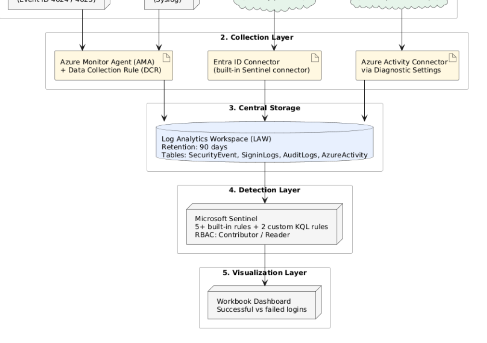
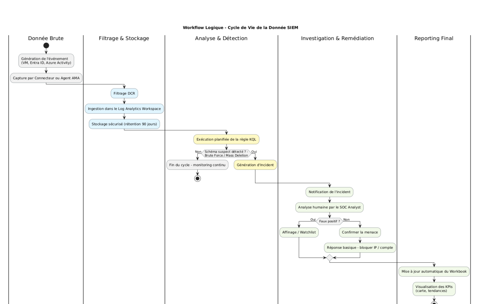
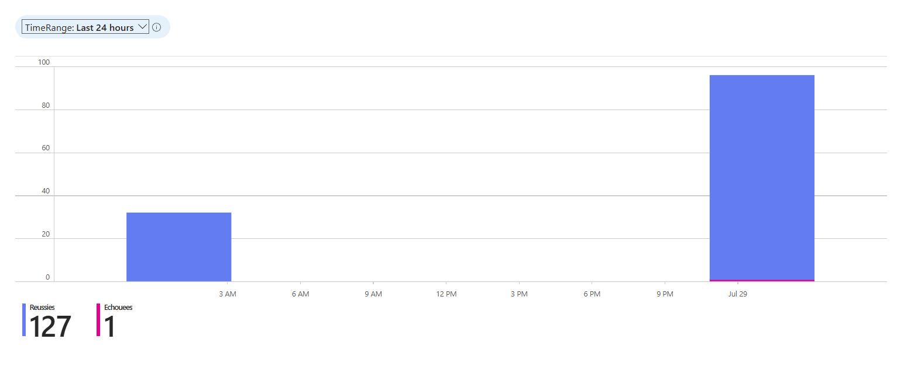
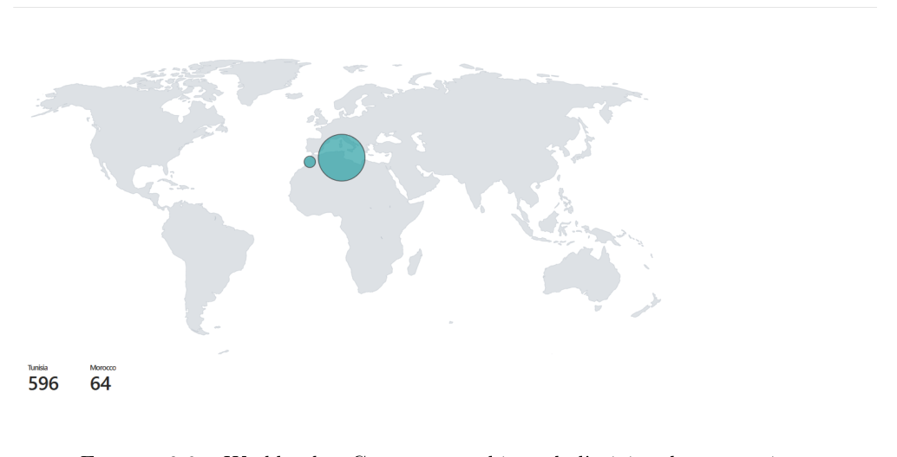

# Azure SIEM Monitoring with Microsoft Sentinel

A cloud-native SIEM implementation built with **Microsoft Azure Monitor**, **Log Analytics** and **Microsoft Sentinel**. The project centralizes security telemetry from Windows, Linux, Microsoft Entra ID and Azure Activity, then applies native and custom detections and presents identity activity in a Workbook.

> **Confidentiality note:** The source internship report is marked confidential by its organization. This repository package intentionally excludes the report itself. Keep this repository **private** unless the organization has explicitly authorized public disclosure. Before making it public, obtain approval and review every screenshot and detail for confidential information.

## Project at a glance

- Centralized telemetry in a Log Analytics workspace.
- Windows and Ubuntu Linux log collection through Azure Monitor Agent (AMA) and Data Collection Rules (DCRs).
- Microsoft Entra ID sign-in and audit log integration.
- Azure subscription activity collection through Diagnostic Settings.
- Five Microsoft Sentinel built-in analytics rules enabled.
- Two custom scheduled KQL detections:
  - Multiple failed Windows logons followed by a successful logon.
  - Repeated Azure resource deletion operations.
- An identity-monitoring Workbook with daily sign-in outcomes and a geographic view.

## Architecture



The solution follows five layers:

1. **Sources:** Windows Server, Ubuntu Linux, Microsoft Entra ID and Azure Activity.
2. **Collection:** AMA + DCR for the VMs; native Entra ID connector; Azure Activity Diagnostic Settings.
3. **Storage:** Log Analytics workspace, configured for 90-day retention in the documented test environment.
4. **Detection:** Microsoft Sentinel built-in analytics rules and custom scheduled KQL rules.
5. **Visualization:** Workbooks for identity sign-in trends and geographic distribution.

The event lifecycle is shown below.



## Technology stack

| Technology | Role |
|---|---|
| Microsoft Azure | Cloud environment |
| Microsoft Sentinel | SIEM analytics, alerts and incidents |
| Log Analytics Workspace | Central log storage and KQL queries |
| Azure Monitor Agent (AMA) | Windows/Linux telemetry collection |
| Data Collection Rules (DCR) | Filter and route VM events |
| Microsoft Entra ID | Identity sign-in and audit telemetry |
| Azure Activity / Diagnostic Settings | Subscription-level activity logs |
| KQL | Hunting, detection and Workbook queries |

## Repository structure

```text
.
├── README.md
├── docs/
│   ├── project-overview.md
│   ├── architecture.md
│   ├── installation-guide.md
│   ├── data-sources.md
│   └── detection-and-workbooks.md
├── architecture/
│   ├── siem-architecture.png
│   └── siem-workflow.png
├── kql/
│   ├── brute-force-detection.kql
│   ├── mass-resource-deletion.kql
│   ├── signins-success-failure-by-day.kql
│   ├── signins-by-country.kql
│   └── validation-queries.kql
├── screenshots/
│   └── workbooks/
│       ├── signins-success-failure.png
│       └── signins-geographic-map.png
└── evidence/
    └── image-sources.md
```

## Custom detection logic

| Detection | Data source | Logic documented in the project |
|---|---|---|
| Brute Force Detection | `SecurityEvent` | At least five failed logons and at least one successful logon, with the last success after the first failure, grouped by account, computer and IP |
| Mass Azure Resource Deletion | `AzureActivity` | At least five delete operations by the same caller in a 10-minute time bucket, within the last hour |

See [`docs/detection-and-workbooks.md`](docs/detection-and-workbooks.md) and the query files in [`kql/`](kql/).

## Workbook evidence

### Successful vs. failed sign-ins



### Geographic distribution of sign-ins



These images are cropped from the internship report's Workbook figures. Values shown are evidence from the documented test environment, not universal performance metrics.

## Deployment summary

The documented implementation used:
- A Log Analytics workspace with 90-day retention.
- A Windows Server 2019 VM and an Ubuntu Server 22.04 LTS VM.
- AMA extensions on both VMs.
- A Windows DCR filtering Security Event IDs `4624` and `4625`.
- A Linux Syslog DCR for selected facilities.
- Entra ID Sign-in Logs and Audit Logs.
- Azure Activity Diagnostic Settings forwarding selected categories to Log Analytics.

For the full, reproducible sequence, see [`docs/installation-guide.md`](docs/installation-guide.md).

## Scope and limitations

The internship report describes a functional lab/reference deployment. It explicitly excludes complex on-premises source integration, advanced SOAR automation and 24/7 operational monitoring. The project should therefore be presented as a SIEM deployment and monitoring implementation, not as a fully managed SOC service.

## Credits and source

Prepared as a portfolio-oriented technical summary of an internship project completed in the Microsoft Azure / Microsoft Sentinel ecosystem. The diagrams and Workbook figures are selected crops from the author's internship report. The full confidential report is not included.


