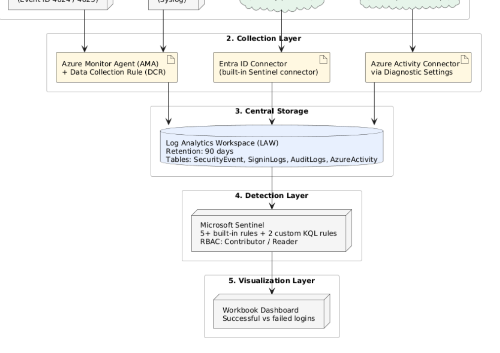

# Architecture

## Logical architecture

The implementation is organized into five layers:

1. **Data sources**
   - Windows Server security events.
   - Linux Syslog events.
   - Microsoft Entra ID sign-in and audit events.
   - Azure subscription activity.

2. **Collection**
   - Azure Monitor Agent (AMA) collects VM telemetry.
   - Data Collection Rules (DCRs) define the Windows and Linux collection scope.
   - The built-in Microsoft Entra ID connector collects sign-in and audit logs.
   - Azure Activity is routed using subscription Diagnostic Settings.

3. **Central storage**
   - A Log Analytics workspace stores the collected records.
   - The documented lab configured 90-day retention.
   - Tables include `SecurityEvent`, `Syslog`, `SigninLogs`, `AuditLogs` and `AzureActivity`.

4. **Detection**
   - Microsoft Sentinel runs built-in analytics rules.
   - Custom scheduled analytics rules use KQL to identify selected patterns.
   - Alerts can be grouped into incidents for analyst investigation.

5. **Visualization**
   - Workbooks display identity sign-in trends and geographic distribution.

## Event workflow

1. An event is generated by a VM, Entra ID or Azure Activity.
2. The appropriate agent or connector captures it.
3. VM events are filtered by DCR and sent to Log Analytics; cloud-native sources are connected through their respective Azure integration.
4. Sentinel analytics evaluate the centralized data.
5. A matching rule can generate an alert/incident for human investigation.
6. Workbook visualizations provide a summary of identity activity.

## Network and access notes from the report

- AMA sends VM telemetry to Log Analytics over encrypted outbound HTTPS on TCP port 443.
- The VM's system-assigned managed identity is used for authentication.
- Azure RBAC roles mentioned in the report include Sentinel Contributor and Reader.

## Data retention

The test workspace was configured for 90 days. This is an environment setting, not a universal recommendation; choose retention according to operational, legal and cost requirements.
