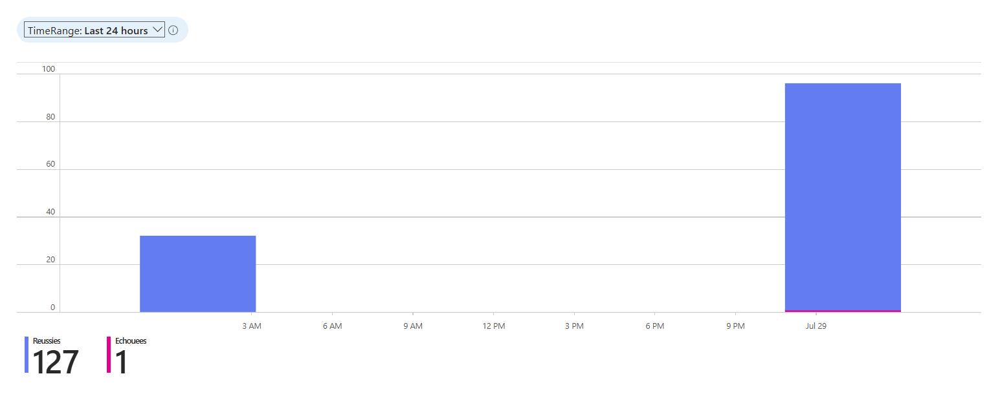
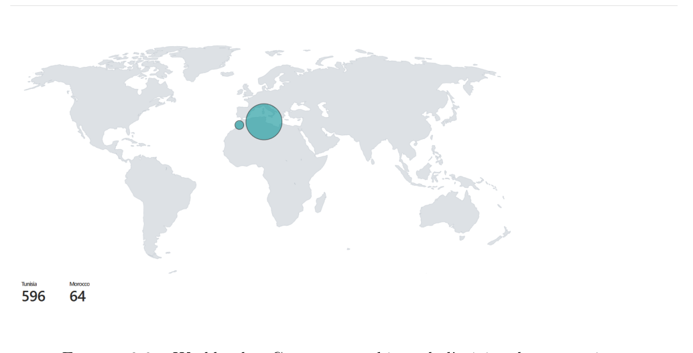

# Detection Rules and Workbooks

## Built-in analytics rules

The internship report records five enabled built-in rules:

1. Suspicious Resource Deployment.
2. Attempts to Sign In to Disabled Accounts.
3. Account Created or Deleted by Non-Approved User.
4. New User Assigned to Privileged Role.
5. Bulk Changes to Privileged Account Permissions.

These are Microsoft-provided detections enabled in the documented environment. Their exact availability and prerequisites may depend on the Sentinel content version and connected data sources.

## Custom rule 1: Brute Force Detection

**Source:** `SecurityEvent`

**Intent:** Find a group of Windows authentication events with at least five failures and at least one success, where the last observed success is later than the first observed failure.

See [`../kql/brute-force-detection.kql`](../kql/brute-force-detection.kql).

The query groups events by account, computer and IP address over the last hour. It is a detection signal for investigation, not proof that an account was compromised.

## Custom rule 2: Mass Azure Resource Deletion

**Source:** `AzureActivity`

**Intent:** Identify at least five delete operations by the same caller in a 10-minute time bucket, within the last hour.

See [`../kql/mass-resource-deletion.kql`](../kql/mass-resource-deletion.kql).

This pattern may indicate malicious activity, an operational mistake or an approved bulk change. Validate the caller, target resources and change context before taking action.

## Identity Workbook

The documented Workbook contains two visualizations.

### Successful vs. failed sign-ins

- Source: `SigninLogs`.
- Time range: last seven days.
- Successful result: `ResultType == "0"`.
- Other result types are counted as failed in the report's query.
- Aggregation: daily.

### Geographic sign-in distribution

- Source: `SigninLogs`.
- Time range: last 30 days.
- Extracts `LocationDetails.countryOrRegion`.
- Excludes events without a country/region value.
- Aggregation: count by country/region.

## Reported validation summary

| Rule | Reported threshold | Source |
|---|---|---|
| Brute Force Detection | At least 5 failed logons + a success after the first failure | `SecurityEvent` |
| Mass Azure Resource Deletion | At least 5 deletions per 10-minute bucket | `AzureActivity` |

The report states that both custom detections were created as scheduled analytics rules. Tune thresholds, query lookback periods, entity mappings and alert grouping to fit the environment before operational use.
